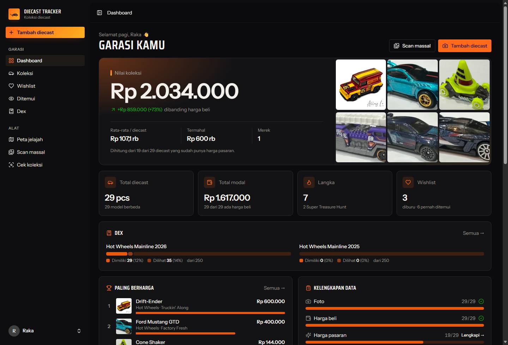
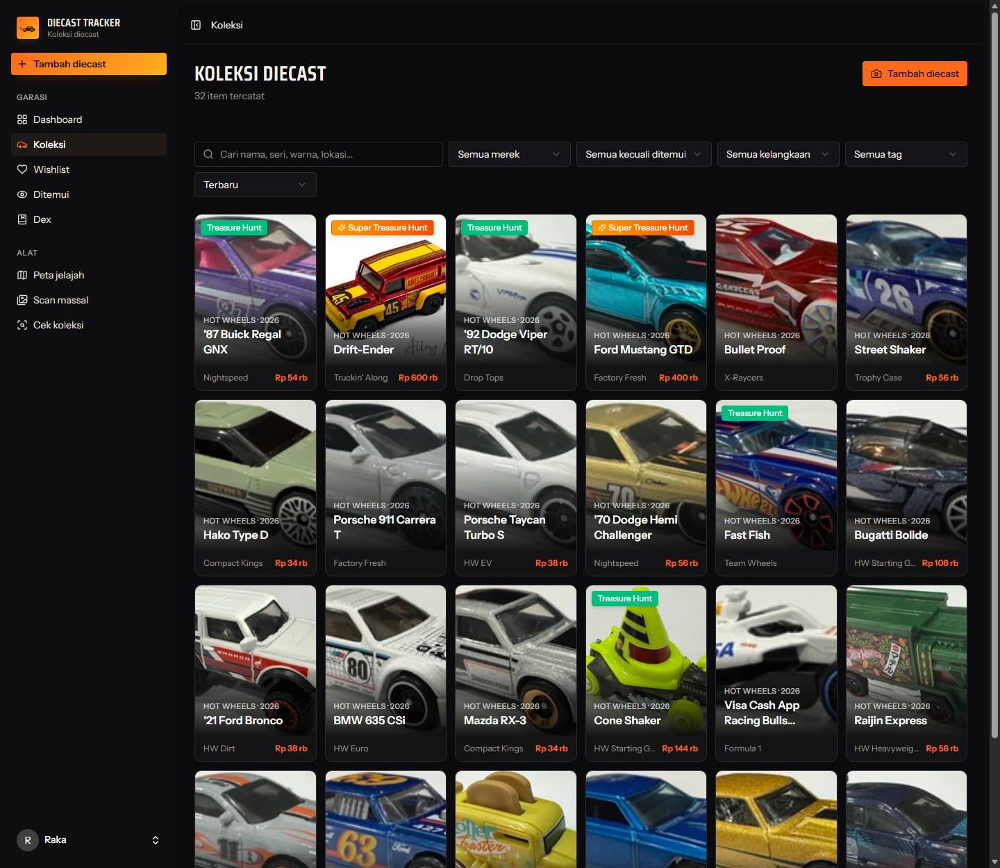
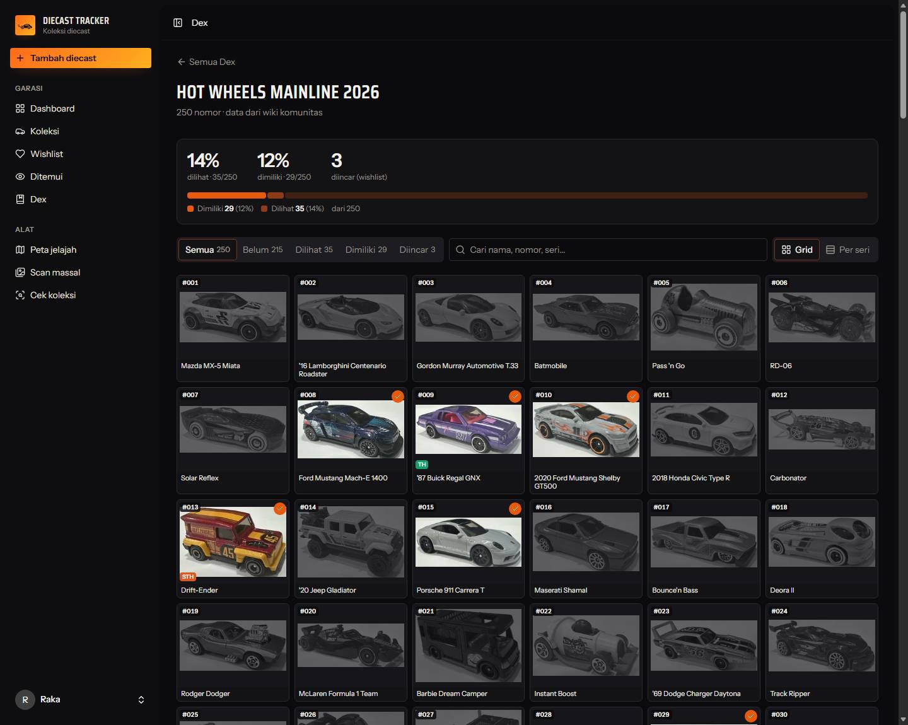
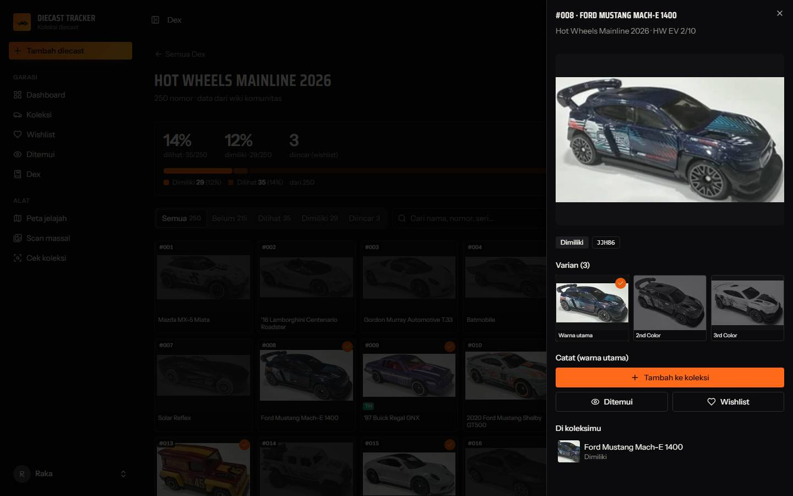
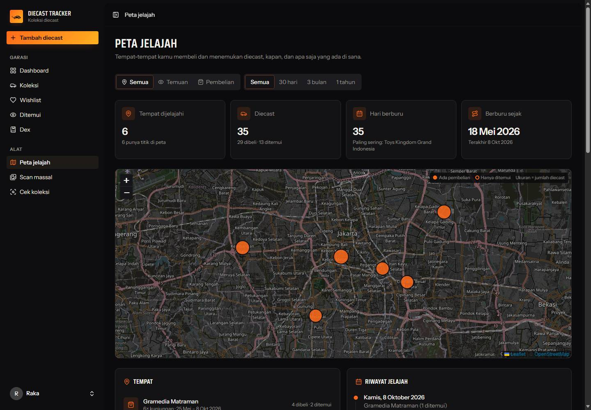
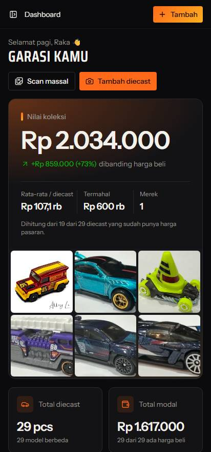
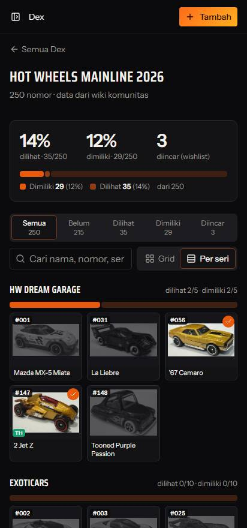
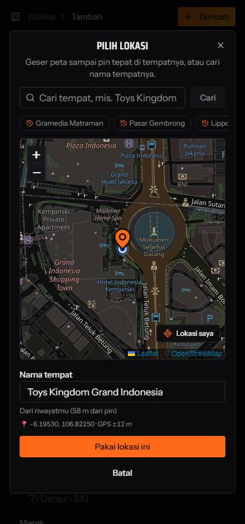

<p align="center">
  
</p>

<h1 align="center">Diecast Tracker</h1>

<p align="center">
  <b>Snap the card. The collection logs itself.</b><br>
  A personal garage for 1:64 diecast collectors: AI photo entry, in-store duplicate checks,<br>
  a Pokédex-style completion tracker, market prices and a map of every hunt.
</p>

<p align="center">
  
  
  
  
  
  
</p>

<p align="center">
  
</p>

---

## Why

Typing in hundreds of Hot Wheels by hand — name, series, collection number, year, rarity — is the reason
most collection spreadsheets die. Diecast Tracker turns a photo of the card into a filled-in record, works
one-handed on a phone in the toy aisle, and answers the questions collectors actually ask:
*do I already have this one, what is it worth, and how much of this year's line have I found?*

The interface is in **Bahasa Indonesia** and prices are in **Rupiah**.

## Features

### 📸 One photo fills the form
- The AI reads the card: model, brand, series, collection number (`61/250 · 2/10`), year, scale, color, rarity
  (Treasure Hunt / Super Treasure Hunt / Chase) and packaging.
- Flags likely duplicates already in your collection before you save.
- **Gemini** (free tier) by default, with automatic fallback across whichever models are currently available;
  **Claude** can be switched on from *Settings → AI Scan*.

### ⚡ Bulk scan
Drop dozens of photos into a queue. They are read one by one at a pace the free quota allows, and every
confident, non-duplicate result can be saved in one go.

### 🛒 In-store check
Photograph a car on the shelf and get an instant verdict: **already owned**, **on your wishlist**,
**seen before**, or **new**. Log the sighting, with the asking price and GPS location, in one tap.

### 📖 Dex — a Pokédex for diecast
- Every **Hot Wheels** and **Matchbox** mainline release from 2015 onwards, synced from the community wikis.
- Progress per year and per series: **seen** (spotted or owned) vs **caught** (owned). Color variants,
  TH/STH and store exclusives count as forms of one entry.
- Your collection is matched to entries automatically — across years, because the year printed on a card is
  the casting's copyright year, not the release year. The matcher suggests the right one.
- Brands without a wiki list (Mini GT, Tarmac, Inno64, local brands) get a **dex of your own**: typed in,
  imported from Excel/CSV, read from checklist screenshots by the AI, or seeded from your collection.

### 💰 Market value from marketplace screenshots
Screenshot a few pages of Tokopedia or Shopee search results. The AI reads every listing and decides which
ones are really the same variant; the app computes the median, the spread and an accuracy rating, and shows
every price it used.

### 🗺️ Hunting map
- Purchases and sightings are geotagged with a map picker: start from GPS, drag the pin to the right shop,
  and the place name follows the pin — your own name for that spot if you have been there, OpenStreetMap otherwise.
- *Peta jelajah* shows every place you have hunted, when, and what you found or bought there.

### 🧰 And the basics, done properly
- Statuses: **owned**, **wishlist** (with target price), **spotted** (with a log of sightings and prices), **sold**.
- Dashboard with collection value, gain over purchase price, rarity mix and data completeness.
- Multiple photos per car, tags, storage location, search and filters.
- Excel import/export and a full **zip backup** that includes every photo.
- Mobile-first dark UI, usable over the LAN from a phone.

## Screenshots

| Collection | Dex |
| :---: | :---: |
|  |  |
| **Dex entry and its variants** | **Hunting map** |
|  |  |

<p align="center">
  
  &nbsp;
  
  &nbsp;
  
</p>

## Tech stack

| Layer | |
| --- | --- |
| Backend | Laravel 13 (PHP 8.3), Fortify auth with passkeys & 2FA |
| Frontend | React 19 + Inertia 3, TypeScript, Tailwind CSS 4, shadcn/ui, Wayfinder route helpers |
| AI | Google Gemini or Anthropic Claude, behind one vision-extraction service with JSON-schema output |
| Maps | Leaflet + OpenStreetMap tiles, Nominatim reverse/forward geocoding (cached) |
| Data | MySQL 8 (SQLite works too), OpenSpout for Excel |

## Getting started

**Requirements:** PHP 8.3+ (with `gd`, `pdo_mysql` and `zip`), Composer, Node.js 20+, MySQL 8.
On Windows, [Laragon](https://laragon.org) covers all of it.

```bash
git clone https://github.com/caropeboka/diecast-tracker.git
cd diecast-tracker

# Create an empty MySQL database called diecast_tracker first (or edit DB_* in .env), then:
composer setup          # install dependencies, create .env, generate the key, migrate, build assets
php artisan storage:link

composer dev            # local development server with hot reload
```

Open the app, register, and add your first car.

### AI scan

Get a free Gemini key from [Google AI Studio](https://aistudio.google.com/apikey) and either put it in `.env`
or paste it into **Settings → AI Scan**, where you can also pick the model and switch to Claude.

```env
SCAN_PROVIDER=gemini        # or: anthropic
GEMINI_API_KEY=your-key
ANTHROPIC_API_KEY=          # only for SCAN_PROVIDER=anthropic
```

### Using it from your phone

```bash
composer phone          # builds assets and serves on 0.0.0.0:8000
```

Connect the phone to the same network (a phone hotspot works) and open `http://<laptop-ip>:8000`.
Browsers only share GPS with secure pages: on plain `http://` either serve the app over HTTPS or add the address
to Chrome's `chrome://flags` → *Insecure origins treated as secure*. Without GPS, the map picker still works by
dragging the map or searching for the place.

### Filling the Dex

Open **Dex**, choose Hot Wheels or Matchbox and a range of years, and press **Sinkron**. Each year takes about
fifteen seconds; catalog thumbnails then download in the background while the page is open, and your collection
is matched to the new entries automatically.

## Testing

```bash
php artisan test
```

The feature suite runs on in-memory SQLite. To run it against MySQL, create a `diecast_tracker_test` database and
run it with `DB_CONNECTION=mysql DB_DATABASE=diecast_tracker_test`.

> **Laragon tip:** if the `zip` extension is not enabled in `php.ini`, run the suite with
> `php -d extension=zip vendor/bin/phpunit` (Excel export and backups need it).

## Project layout

```text
app/Services/
├── AiVision.php            # one vision-extraction API over Gemini and Claude, with model fallback
├── DiecastScanner.php      # card photo → form fields
├── PriceChecker.php        # marketplace screenshots → listings
├── PriceAnalyzer.php       # listings → median, spread, accuracy
├── PlaceLookup.php         # GPS ↔ place names (own history first, then OpenStreetMap)
├── CollectionBackup.php    # zip backup and restore, photos included
└── Dex/
    ├── WikiTableParser.php # MediaWiki tables → rows keyed by column header
    ├── WikiCatalog.php     # Hot Wheels / Matchbox year lists and thumbnails
    ├── CatalogSync.php     # idempotent sync that keeps collection links stable
    ├── CatalogMatcher.php  # collection ↔ dex entries, across years
    ├── CatalogProgress.php # seen / caught per year and per series
    └── CatalogImport.php   # own dex lists: manual, spreadsheet, AI screenshots, collection
resources/js/
├── pages/                  # Inertia pages (dashboard, diecasts, dex, explore, settings…)
└── components/             # diecast form, location picker, dex meter, charts…
```

## Data sources & credits

- **Release lists and catalog photos** come from the [Hot Wheels Wiki](https://hotwheels.fandom.com) and
  [Matchbox Wiki](https://matchbox.fandom.com) communities under **CC BY-SA**. They are fetched through the
  MediaWiki API only when you press *Sinkron*, with paced requests; thumbnails are stored locally because the
  wikis don't allow hotlinking. Attribution is shown in the app.
- **Maps** © [OpenStreetMap](https://www.openstreetmap.org/copyright) contributors; place names via
  Nominatim, cached and kept within its usage policy.
- The screenshots above use demo data; the car photos in them are Hot Wheels Wiki catalog thumbnails.

Hot Wheels and Matchbox are trademarks of Mattel, Inc. This is an independent fan project and is not affiliated
with or endorsed by Mattel, Fandom or the wiki communities.
